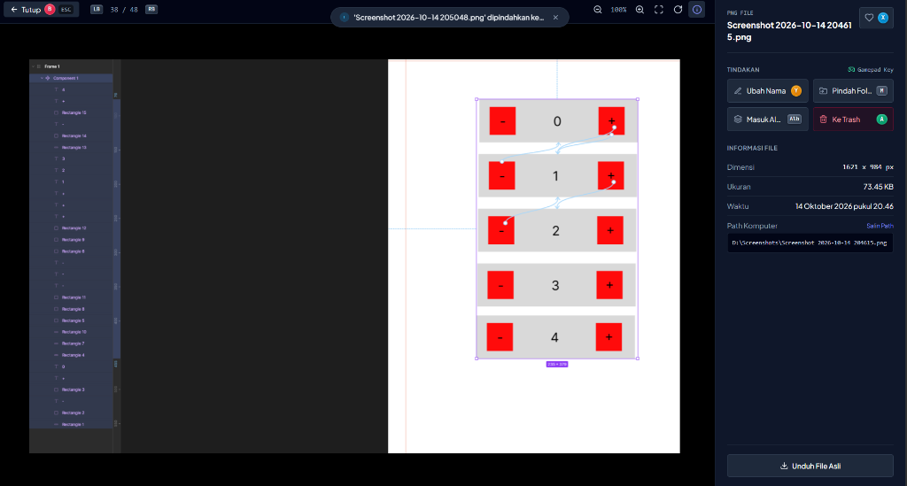
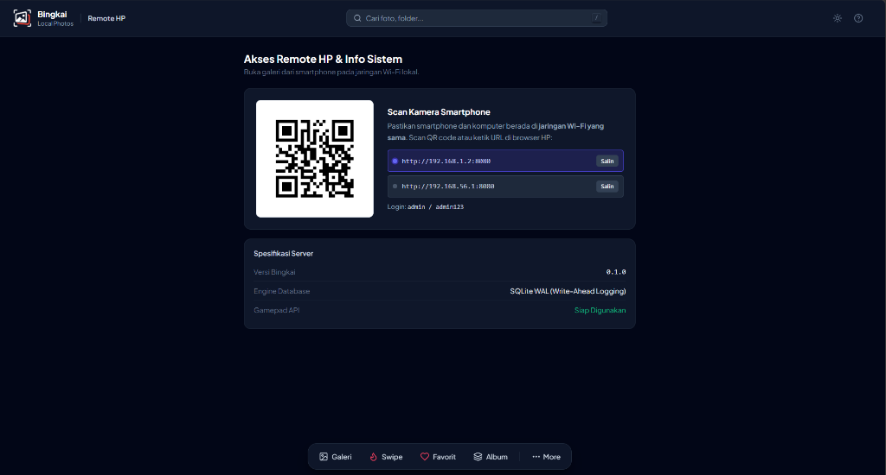
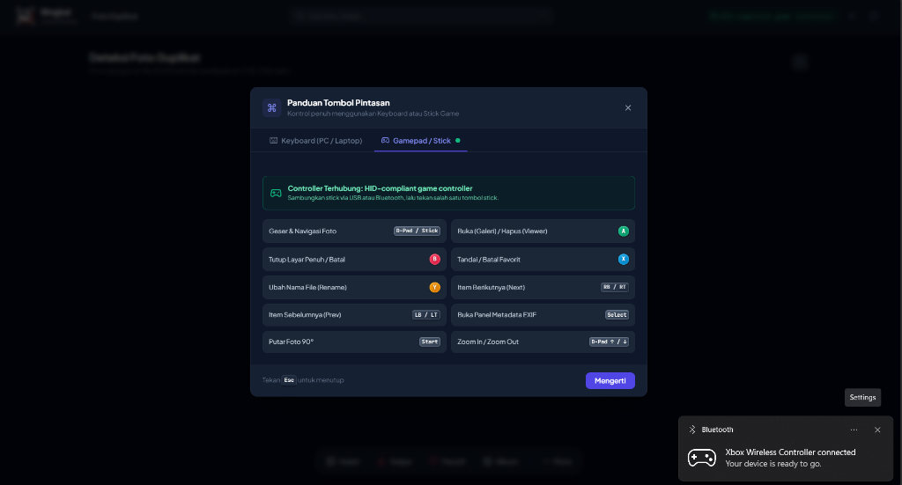

# Bingkai - Local-First Photo Manager & Remote Controller

> Bringing scattered memories back into structure.

A local-first photo management platform designed to organize and curate massive local image collections on desktop workstations. Bingkai offers high-performance indexing, responsive glassmorphism interfaces, and wireless navigation via smartphones (local Wi-Fi) or hardware gamepads (Gamepad API).

---

## Architectural Concept

Bingkai operates strictly on the user local machine without uploading images to third-party cloud infrastructure:
1. Physical images remain untouched in their original filesystem directories.
2. An embedded SQLite database stores file indexes, EXIF metadata, dimensions, and SHA-256 hashes.
3. The backend generates lightweight WebP thumbnails with automatic EXIF orientation for fast rendering.
4. Users can browse and curate collections from a desktop monitor, a smartphone over local Wi-Fi, or an armchair using a wireless gamepad.

---

## Application Interface Previews

### Photo Viewer & File Inspector


### Wireless Smartphone Remote Controller (Local Wi-Fi)


### Hardware Gamepad Controller Navigation (PlayStation & Xbox)


---

## Core Capabilities

- 100% Local-First Privacy: All metadata indexing, thumbnail caching, and file operations execute locally on the host machine. Zero telemetry or media bytes are transmitted externally.
- Gamepad & Stick Controller Integration: Navigate photo grids, zoom, inspect metadata, and curate collections using USB or Bluetooth controllers (Xbox Wireless, DualShock/DualSense, Logitech) via the standard Gamepad API.
- Smartphone Remote Navigation: Access and curate image libraries from mobile browsers over local Wi-Fi without installing native mobile applications.
- Safe Trash & Restore System: Non-destructive deletion moves files into an isolated trash directory, allowing single-click restoration or permanent disposal.
- Secure Rename and Relocation: Rename files and transfer photos between indexed folders with strict directory traversal validation and collision resolution.
- Non-Destructive Virtual Albums: Organize thematic collections without duplicating or restructuring underlying physical directories.
- Byte-Identical Duplicate Detection: Identifies exact duplicate files via cryptographic SHA-256 hashing to reclaim disk capacity.
- High-Throughput Performance: Optimized SQLite engine operating in WAL (Write-Ahead Logging) mode, HttpOnly session authentication, and asynchronous Pillow WebP thumbnail processing.
- Responsive Modern UI: Fluid dark-mode glassmorphism interface powered by Alpine.js and Tailwind CSS.

---

## Hardware Gamepad Mapping

Bingkai interfaces with browser Gamepad API implementations:

| Button / Control | Action |
|:---|:---|
| **D-Pad / Left Analog** | Traverse photo grid selections |
| **A / Cross** | Open selected photo in Fullscreen Viewer |
| **B / Circle** | Close viewer and return to grid |
| **X / Square** | Toggle Favorite status |
| **Y / Triangle** | Open file rename dialog |
| **LB / RB** | Paginate gallery pages |

### To Use a Controller:
1. Connect your gamepad to your PC via USB cable or Bluetooth.
2. Open Bingkai in your browser (`http://localhost:8080`).
3. Press any button on the controller to wake the browser Gamepad API.
4. An on-screen indicator will confirm active gamepad connectivity.

---

## Smartphone Remote Setup

1. Ensure the host computer and smartphone are connected to the same Wi-Fi subnet.
2. Open a mobile browser (Chrome, Safari, or Firefox).
3. Navigate to the local host IP and port:
   ```text
   http://192.168.1.x:8080
   ```
4. Authenticate using default credentials:
   - Username: `admin`
   - Password: `admin123`
5. The full desktop photo library can now be curated wirelessly from the mobile display.

---

## Setup and Installation

### Prerequisites
- Python 3.10 or higher
- Windows, macOS, or Linux

### Installation Steps

1. Clone the repository:
   ```bash
   git clone https://github.com/ANTARTICA1/bingkai-app.git
   cd bingkai-app
   ```

2. Install Python dependencies:
   ```bash
   pip install -r requirements.txt
   ```

3. Start the application server:
   ```bash
   python -m uvicorn backend.main:app --host 0.0.0.0 --port 8080 --reload
   ```

4. Access the portal:
   - Host Computer: `http://localhost:8080`
   - Mobile Devices on LAN: `http://<HOST-LAN-IP>:8080`

---

## Project Structure

```
bingkai-app/
├── backend/
│   ├── config.py              # Directory paths, secret keys, and LAN IP detection
│   ├── database.py            # SQLite engine configuration and WAL mode pragma
│   ├── models.py              # SQLAlchemy ORM models (User, Folder, Photo, Album)
│   ├── schemas.py             # Pydantic validation schemas
│   ├── security.py            # Bcrypt hashing, session tokens, and path verification
│   ├── scanner.py             # Recursive directory scanner, EXIF parser, SHA-256 hasher
│   ├── thumbnail_service.py   # Pillow WebP thumbnail generator with EXIF auto-rotation
│   ├── photo_service.py       # Domain logic: sorting, filtering, trash, move, albums
│   └── main.py                # FastAPI endpoints, CORS, static routes, auth router
├── frontend/
│   ├── index.html             # Alpine.js and Tailwind CSS single-page interface
│   ├── css/style.css          # Glassmorphism styling and custom scrollbars
│   ├── js/api.js              # Fetch API client
│   └── js/app.js              # State management and Gamepad input loop
├── docs/screenshots/          # Interface preview assets
├── requirements.txt           # Python package dependencies
└── README.md                  # Technical documentation
```

---

## Security Architecture

- Directory Traversal Mitigation: Validates realpath boundaries on all file operations, preventing escape outside designated index roots.
- Filename Sanitization: Disallows null bytes, shell metacharacters, and relative path specifiers during file manipulation.
- Signed Session Cookies: Stateless cryptographically signed tokens delivered over HttpOnly cookies.
- Local Isolation: Runtime databases, cache folders, and trash directories are excluded from Git version control.

---

## Author

Anak Agung Ngurah Krisna Artha Wibawa ([ANTARTICA1](https://github.com/ANTARTICA1))

## License

This project is licensed under the MIT License.